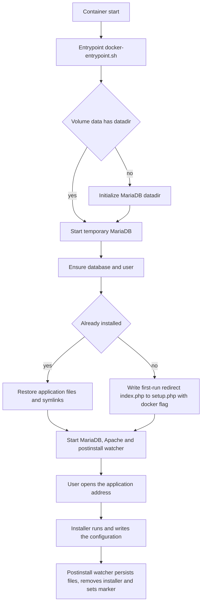

# Planejamento — Imagem Docker do TilBuci

> **Objetivo deste documento:** descrever, de forma detalhada, como deve ser a imagem Docker do TilBuci e como construí-la, atendendo aos requisitos de [`tilbuci-docker.md`](tilbuci-docker.md).
>
> **Idioma:** este planejamento está em português, conforme solicitado. Entretanto, **todos os artefatos gerados para a imagem** — código (`Dockerfile`, scripts de entrada, scripts de instalação), nomes de variáveis de ambiente, `labels`, mensagens de log, nomes de arquivos/pastas internas e o README embutido — devem estar **em inglês**, conforme a regra do modelo base.

---

## 1. Requisitos derivados do modelo

Extração dos pontos relevantes de [`tilbuci-docker.md`](tilbuci-docker.md:1), dos documentos de apoio [`models/tilbuci.md`](../models/tilbuci.md:1) e [`models/site.md`](../models/site.md:1) e do instalador real em [`docker/setup`](setup):

| # | Requisito | Fonte |
| --- | --- | --- |
| R1 | Aplicação web acessada por navegador, servida em HTML/CSS/JS | [`tilbuci-docker.md`](tilbuci-docker.md:11) |
| R2 | Ambiente testado: Linux (Ubuntu), Apache, PHP 8+, MariaDB | [`tilbuci-docker.md`](tilbuci-docker.md:13) |
| R3 | Instalação via `setup.php`, solicitando dados do banco, e-mail e modo (`multi` ou `single`) | [`tilbuci-docker.md`](tilbuci-docker.md:20) |
| R4 | O mesmo script serve para atualização de uma instalação existente, sem pedir dados | [`tilbuci-docker.md`](tilbuci-docker.md:28) |
| R5 | Estrutura de pastas fixa após a instalação (`app`, `database`, `events`, `export`, `language`, `public_html` e subpastas) | [`tilbuci-docker.md`](tilbuci-docker.md:32) |
| R6 | Persistência: `app/Config.php`, `public_html/app/player.json`, `public_html/app/editor.json`, `public_html/movie`, `public_html/font`, `public_html/sites`, `public_html/pwa` + a base de dados | [`tilbuci-docker.md`](tilbuci-docker.md:56) |
| R7 | A atualização sobrescreve os arquivos do servidor web e altera a base | [`tilbuci-docker.md`](tilbuci-docker.md:66) |
| R8 | Modo `multi` (login) ou `single` (acesso direto); modo multi é o recomendado para web | [`models/tilbuci.md`](../models/tilbuci.md:116) |
| R9 | Repositório de releases / pacote instalador | [`models/tilbuci.md`](../models/tilbuci.md:204) |
| **R10** | Na **primeira execução**, o contêiner sobe **sem prompt e sem parâmetros**; a primeira visita ao endereço é redirecionada para `setup.php?docker=true`, onde o instalador (com o banco já configurado) pede **e-mail, senha inicial e modo**. | Definido com o usuário |
| **R11** | O instalador da versão mais recente estará **sempre** na pasta [`docker/setup`](setup) deste projeto, e é a fonte da verdade para o build | Definido com o usuário |
| **R12** | O sistema deve ter **suporte a ZIP**: extensões PHP relativas ao ZIP disponíveis e habilitadas (`zip`/`ZipArchive`, `zlib`) e os utilitários `zip`/`unzip`. O instalador extrai [`part1.zip`](setup/setup/part1.zip)/[`part2.zip`](setup/setup/part2.zip)/[`part3.zip`](setup/setup/part3.zip) e o TilBuci importa/exporta *movies* como ZIP | Requisito do usuário |

### 1.1 Descobertas do instalador real (fonte: [`docker/setup/setup.php`](setup/setup.php:1) e [`docker/setup/README.txt`](setup/README.txt:1))

Estes fatos moldam o design e **corrigem** suposições iniciais:

1. **Estrutura do instalador:** [`docker/setup`](setup) contém:
   - [`setup.php`](setup/setup.php:1) — instalador/atualizador (versão interna `26`);
   - [`setup/part1.zip`](setup/setup/part1.zip), [`setup/part2.zip`](setup/setup/part2.zip), [`setup/part3.zip`](setup/setup/part3.zip) — arquivos do TilBuci;
   - [`setup/database/`](setup/setup/database) — `tilbuci.sql` (esquema inicial) + scripts incrementais `1.sql`…`24.sql` (e variantes `-sqlite`).
2. **Destino dos arquivos:** o conteúdo de [`docker/setup`](setup) vai para a **raiz pública** (`public_html`). `part1.zip` é extraído para `../` (raiz do pacote, ex.: `app/`, `database/`, `export/`, `language/`); `part2.zip`/`part3.zip` para `./` (`public_html/`).
3. **Controle por `$_POST`:** o script age conforme `$_POST['ac']`:
   - `ac=1` → **nova instalação** (grava [`Config.php`](setup/setup.php:329), [`player.json`](setup/setup.php:330), [`editor.json`](setup/setup.php:347); executa `tilbuci.sql` + incrementais; cria usuário admin);
   - `ac=3` → **atualização** (usa `$_POST['current']` = versão atual do banco, roda incrementais e re-extrai arquivos);
   - `ac=4` → **sobrescrever arquivos** da mesma versão.
4. **Variáveis de saída em escopo:** ao incluir o script, `$iinfo['page']` indica o resultado (1 = instalação OK; 3/4/5/7 = estados de atualização; 0/2/6 = erro) e `$warn` traz a mensagem de erro. Isso permite um *wrapper* CLI confiável.
5. **`$sinfo['host']` vem de `$_SERVER['HTTP_HOST']` + `$_SERVER['SCRIPT_NAME']`** (com esquema `http`/`https`). Esse valor vira `path` no [`Config.php`](setup/setup.php:309) e a base em `player.json`/`editor.json`. Logo, o wrapper CLI **precisa simular** essas variáveis (ver §9).
6. **Autolimpeza:** ao concluir, o instalador **apaga** `setup/` e os ZIPs. Portanto, a imagem deve manter uma **cópia pristina** do instalador fora de `public_html` para permitir atualizações futuras.
7. **Senha inicial do admin = `password`** (via `md5('password')` em [`setup.php`](setup/setup.php:287)), e não o e-mail. A mensagem de sucesso orienta trocar no primeiro acesso. *(Observação: o [`models/tilbuci.md`](../models/tilbuci.md:162) cita “senha = e-mail”, o que não corresponde a este instalador; vale confirmar junto ao projeto.)*
8. **Bibliotecas PHP exigidas** ([`README.txt`](setup/README.txt:10)): `curl`, `imap`, `mbstring`, `pdo`/`pdo_mysql`, `zip`. Atenção especial a **`php-imap`**, que costuma não vir por padrão.
9. **Suporte a SQLite:** o instalador aceita `databaseServ = 'sqlite'` (arquivo `movie/tilbuci.sqlite`), gerando variantes `-sqlite` dos scripts. É uma **alternativa** que dispensa o daemon do banco (ver §2.2).
10. **Possível serviço WebSocket:** há a pasta `public_html/ws` e a chave `ws` em `player.json`/`editor.json`. A confirmar se exige um processo dedicado (ver §6 e §15).

---

## 2. Decisões de arquitetura

| Decisão | Escolha | Justificativa |
| --- | --- | --- |
| Topologia | **Imagem única "all-in-one"** com Apache + PHP 8 + MariaDB | Definido com o usuário; execução com um único `docker run` |
| Distribuição base | **Ubuntu LTS 24.04** | Fidelidade ao ambiente testado (R2); PHP 8.3, Apache 2.4 e MariaDB 10.11 nos repositórios |
| Servidor web | **Apache 2.4** com `mod_php` | Servidor do ambiente de referência |
| Banco | **MariaDB 10.11** (datadir interno, acesso via socket local) | Atende “MariaDB 10.2 ou superior” (R2) |
| Fonte do pacote | **Cópia local de [`docker/setup`](setup)** no build (R11) | Não depende de download externo; versão controlada no repositório |
| Instalação | **Primeira execução via navegador**: a raiz redireciona para `setup.php?docker=true`; um *watcher* sob supervisord persiste a configuração e remove o instalador | Atende R10 |
| Provisionamento do banco | Automático (nome/usuário/senha gerados ou via env) | O usuário informa apenas e-mail e modo |
| Persistência | **Volume único `/data`** + *symlinks* recriados a cada start | Simplifica o `docker run` |
| Idioma dos artefatos | Inglês (código, variáveis, mensagens, labels) | Regra do modelo base |

### 2.1 Por que imagem única e não *docker-compose*

Vantagens: um único artefato, distribuição e execução simples. Trade-offs a documentar no README: exige gerenciador de processos (§6); escala horizontal não é o foco (é *self-hosting* simples); para ambientes maiores, a evolução natural é separar o banco em outro contêiner.

### 2.2 Alternativa considerada: SQLite em vez de MariaDB

Como o instalador suporta SQLite (item 9 da §1.1), seria possível uma variante **sem o daemon do banco**, deixando o contêiner com **apenas Apache/PHP** (mais leve e com um único processo). Mantém-se **MariaDB como padrão** por fidelidade a R2, mas recomenda-se documentar a variante SQLite como opção simplificada.

---

## 3. Estrutura interna da imagem (layout de arquivos)

```
/var/www/tilbuci/                     <- TILBUCI_ROOT (raiz do pacote)
├── app/                              <- inclui Config.php (persistente)
├── database/
├── events/
├── export/
│   ├── desktop/ iframe/ mobile/ publish/ pwa/ runtimes/ site/
├── language/
└── public_html/                      <- DocumentRoot do Apache
    ├── setup.php                     <- instalador (copiado de docker/setup)
    ├── setup/                        <- part1..3.zip + database/*.sql
    ├── app/                          <- player.json e editor.json (persistentes)
    ├── download/
    ├── editor/
    ├── font/                         <- persistente
    ├── movie/                        <- persistente
    ├── ws/                           <- componente WebSocket do TilBuci (index.php + launcher.php) — SEMPRE mantido
    ├── sites/                        <- persistente (criada sob demanda)
    └── pwa/                          <- persistente (criada sob demanda)

/opt/tilbuci-installer/               <- CÓPIA PRISTINA do instalador (sourced de docker/setup)
│                                          usada para reinstalar/atualizar após a autolimpeza

/data/                                <- VOLUME único de persistência
├── app/
│   ├── Config.php
│   ├── player.json
│   └── editor.json
├── movie/
├── font/
├── sites/
├── pwa/
├── backups/                         <- dumps do banco antes de atualizações
├── mysql/                           <- datadir do MariaDB
└── .tilbuci-installed               <- marcador de instalação concluída
```

- `TILBUCI_ROOT=/var/www/tilbuci` e `DocumentRoot=/var/www/tilbuci/public_html`.
- Os caminhos persistentes (R6) são **symlinks** apontando para `/data`, recriados pelo entrypoint a cada inicialização (§7.3).

---

## 4. Fluxo geral (diagrama)



---

## 5. Dockerfile — etapas de construção

### 5.1 Etapa base e sistema

1. `FROM ubuntu:24.04` (LTS).
2. `ENV DEBIAN_FRONTEND=noninteractive`, `TZ`, `LANG` e variáveis `TILBUCI_*` (§8).
3. `apt-get update && apt-get install -y`:
   - `apache2`, `libapache2-mod-php`, `mariadb-server`, `mariadb-client`
   - **PHP (obrigatórios):** `php`, `php-cli`, `php-mysql` (pdo_mysql), `php-imap`, `php-mbstring`, **`php-zip` (ZipArchive)**, `php-curl`
   - **PHP (recomendados):** `php-xml`, `php-gd`, `php-intl`, `php-json`, `php-bcmath`
   - **ZIP (obrigatório — R12):** além de `php-zip`, incluir `zlib`/`libzip` (dependência do `ZipArchive`) e os utilitários `zip` e `unzip`.
     *(o conjunto mínimo obrigatório é `curl, imap, mbstring, pdo_mysql, zip`; os demais são prudentes para o editor/exportação; **o suporte a ZIP é indispensável**)*
   - utilitários: `curl`, `unzip`, `zip`, `ca-certificates`, `tini` (ou `supervisor`)
4. **A confirmar:** necessidade de `php-imagick`/`php-gmagick` (imagem) e de `nodejs`/`npm` (toolchain de exportação Electron/Cordova citada em [`models/tilbuci.md`](../models/tilbuci.md:133)). Incluir Node.js **somente se** a exportação server-side exigir.
5. **Verificar suporte a ZIP (R12):** confirmar no build que a classe `ZipArchive` existe (`php -r "var_dump(class_exists('ZipArchive'));"`) e que `zip`/`unzip` estão no PATH. O [`setup.php`](setup/setup.php:98) usa `ZipArchive` para extrair os ZIPs do instalador, e o TilBuci importa/exporta *movies* como ZIP.

### 5.2 Apache

1. Habilitar `rewrite`; definir `DocumentRoot=/var/www/tilbuci/public_html`.
2. Criar `/etc/apache2/sites-available/tilbuci.conf` com `AllowOverride All` (uso de `.htaccess`).
3. Ajustar `php.ini` (`upload_max_filesize`, `post_max_size`, `memory_limit`, `max_execution_time`) para importar *movies* (ZIPs) grandes.
4. Ajustar `max_allowed_packet` do MariaDB para *dumps*/importações grandes.

### 5.3 Instalação do pacote TilBuci (usando [`docker/setup`](setup))

1. Copiar o **conteúdo** de [`docker/setup`](setup) para a **raiz pública**:
   - `COPY setup/ /var/www/tilbuci/public_html/` → instala [`setup.php`](setup/setup.php:1), [`setup/part1.zip`](setup/setup/part1.zip), [`setup/part2.zip`](setup/setup/part2.zip), [`setup/part3.zip`](setup/setup/part3.zip) e [`setup/database/*.sql`](setup/setup/database).
2. Manter uma **cópia pristina** para atualizações futuras:
   - `COPY setup/ /opt/tilbuci-installer/` (aplicada novamente quando necessário, §9.4).
3. `chown -R www-data:www-data /var/www/tilbuci` e permissões adequadas.
4. **Não** executar a instalação no build: depende de valores do primeiro start (R10).

### 5.4 Metadados e artefatos

- `LABEL` OCI (`org.opencontainers.image.title`, `.description`, `.version`, `.licenses`, `.source`) — em inglês. `org.opencontainers.image.version` usa a **versão do pacote Docker** (`DOCKER_VERSION`, ex.: `26.0.0`); `org.tilbuci.app.version` registra a **versão do TilBuci** (`TILBUCI_VERSION`, `26`).
- `EXPOSE 80`; `VOLUME /data`.
- `HEALTHCHECK` chamando um endpoint HTTP interno.
- `ENTRYPOINT ["/usr/local/bin/docker-entrypoint.sh"]` (com `tini` se adotado) e `CMD` para o supervisor.

---

## 6. Gerenciamento de processos no contêiner

Como o contêiner roda **dois** serviços (MariaDB + Apache), o PID 1 deve tratar sinais e reinício:

- **Preparação:** `tini` + entrypoint que, ao final da fase interativa/instalação, faz `exec` para o supervisor.
- **Supervisor:** `supervisord` gerencia:
  - `mariadbd` — `autorestart=true`, `stopsignal=TERM`;
  - `apache2 -DFOREGROUND`;
  - **possivelmente** um **servidor WebSocket** para `public_html/ws` (ver §15) — a confirmar.
- Alternativa sem supervisor: script bash com `mariadbd --user=mysql &` + `trap` para `mysqladmin shutdown` + `exec apache2 -DFOREGROUND`.

> A fase de **prompt interativo** ocorre **antes** de entregar o controle ao supervisor (que não é interativo), conforme o fluxo da §4.

---

## 7. Entrypoint e primeiro start

Arquivo: `/usr/local/bin/docker-entrypoint.sh` (+ scripts auxiliares em `/usr/local/bin/`).

### 7.1 Inicialização do MariaDB

1. Se `/data/mysql` estiver vazio: `mariadb-install-db --datadir=/data/mysql`.
2. Subir um `mariadbd` temporário via socket local (`/run/mysqld/mysqld.sock`).
3. Criar (idempotente) a base `TILBUCI_DB_NAME` e o usuário `TILBUCI_DB_USER` com a senha `TILBUCI_DB_PASSWORD` (padrão `S3nh4Dogg0`; persistida em `/data/.db_password` e no `Config.php`).
4. Acesso do PHP via `localhost` (socket), evitando expor TCP.

### 7.2 Primeira execução (via navegador, R10)

Não há prompt nem parâmetros de configuração no start. Ao subir pela primeira vez:

1. O entrypoint copia o instalador, aplica os symlinks e **grava um `index.php` temporário** que redireciona para `setup.php?docker=true`.
2. O Apache e o MariaDB sobem normalmente (o contêiner se comporta como nos starts seguintes).
3. Ao abrir o endereço do aplicativo, o instalador (já com o banco configurado) pede **e-mail, senha inicial e modo**.
4. Um **watcher** sob supervisord (`bin/tilbuci-postinstall.sh`) detecta a conclusão, move `Config.php`/`player.json`/`editor.json` para `/data`, remove o instalador e grava o marcador `.tilbuci-installed`.

### 7.3 Aplicação dos symlinks de persistência

Antes de iniciar os serviços, a cada boot:

1. Garantir `/data/{app,movie,font,sites,pwa}`.
2. Recriar os symlinks do servidor web para `/data`:
   - `app/Config.php` → `/data/app/Config.php`
   - `public_html/app/player.json` → `/data/app/player.json`
   - `public_html/app/editor.json` → `/data/app/editor.json`
   - `public_html/movie` → `/data/movie`
   - `public_html/font` → `/data/font`
   - `public_html/sites` → `/data/sites` (criar sob demanda)
   - `public_html/pwa` → `/data/pwa`
3. Corrigir dono (`www-data`) e permissões.

> **Mitigação de R7 (atualização):** como a atualização sobrescreve os arquivos web, os symlinks podem ser removidos durante o processo. Por isso os symlinks são **recriados a cada start** (auto-reparo) e o wrapper de atualização (`tilbuci-update`, §9.4) reaplica os symlinks **após** o `setup.php` concluir. O README deve orientar reiniciar o contêiner após atualizar.

### 7.4 Detecção de instalação e atualização

- Se `/data/.tilbuci-installed` **não** existir → primeira instalação (§9.2).
- Se **existir** → reaplica symlinks e serviços. **Importante:** os arquivos da aplicação (extraídos de `part1/2/3.zip`) **não são persistentes**; ao recriar o contêiner com o volume existente, eles somem. O entrypoint chama `ensure_application_files`, que decide a ação:
  - se `config.dbVersion` **for anterior** à versão do instalador embarcado → faz **backup do banco** em `/data/backups` e roda a **atualização automática** (`--action=3`, arquivos + migrações), controlada por `TILBUCI_AUTO_UPDATE` (padrão `true`);
  - caso contrário (arquivos ausentes, mesma versão) → `--action=4` (apenas reextrai arquivos).
  Em ambos os casos, `Config.php`/`player.json`/`editor.json` e a base são **preservados**. A atualização também pode ser feita manualmente pela rota web (`/setup.php`) ou pelo wrapper `tilbuci-update` (§9.4).

### 7.5 Encerramento gracioso

- `trap` para `SIGTERM`/`SIGINT` → `mysqladmin shutdown` e parada do Apache; `STOPSIGNAL SIGTERM` refletido no supervisor.

---

## 8. Variáveis de ambiente

Todos os nomes em inglês. A primeira execução é feita pelo **navegador** (R10); o contêiner não exige parâmetros de configuração no start.

| Variável | Padrão | Descrição |
| --- | --- | --- |
| `TZ` | `UTC` | Fuso horário do contêiner |
| `TILBUCI_URL` | `http://localhost/` | URL pública base. Reaplicada a cada start (via `tilbuci-set-url`) para ajustar `Config.path` e as bases de `player.json`/`editor.json` |
| `TILBUCI_DB_NAME` | `tilbuci` | Nome da base |
| `TILBUCI_DB_USER` | `tilbuci` | Usuário da base |
| `TILBUCI_DB_PASSWORD` | `S3nh4Dogg0` | Senha do usuário `tilbuci`; persistida em `/data/.db_password` e no `Config.php` (troque em produção) |
| `TILBUCI_AUTO_UPDATE` | `true` | No start, se a versão do banco for anterior à do instalador embarcado, faz backup do banco (`/data/backups`) e executa a atualização automaticamente |
| `TILBUCI_KEEP_SETUP` | `false` | Se `true`, mantém `setup.php` acessível após instalar (útil para depuração) |
| `TILBUCI_DATA_DIR` | `/data` | Caminho do volume de persistência |

> **Senha inicial do admin:** agora é definida pelo próprio usuário no instalador (navegador) no primeiro acesso, junto com o e-mail e o modo de acesso.

---

## 9. Instalador headless (adaptação do `setup.php`)

Objetivo: executar o instalador existente sem navegador para **atualização** (`--action=3`) e **reextração de arquivos** (`--action=4`), aproveitando o fato de que o [`setup.php`](setup/setup.php:1) é dirigido por `$_POST` e expõe `$iinfo['page']`/`$warn`. A **instalação inicial** agora é feita pelo navegador (`setup.php?docker=true`).

### 9.1 Wrapper CLI (recomendado, baixo impacto no `setup.php`)

Criar `bin/install.php` que **simula a requisição web** e inclui o instalador:

```php
<?php
// bin/install.php  (headless installer wrapper)
$opts = getopt('', [
    'action:', 'email::', 'mode::', 'url::',
    'db-host::', 'db-name::', 'db-user::', 'db-pass::', 'db-port::', 'current::',
]);

$url    = $opts['url']   ?? getenv('TILBUCI_URL') ?: 'http://localhost/';
$email  = $opts['email'] ?? getenv('TILBUCI_EMAIL');
$mode   = $opts['mode']  ?? getenv('TILBUCI_INSTALL_MODE') ?: 'multi';
$action = $opts['action'] ?? '1'; // 1=install, 3=update, 4=override

$pub = '/var/www/tilbuci/public_html';

// Deriva esquema, host e prefixo a partir de TILBUCI_URL
$parts  = parse_url($url);
$scheme = $parts['scheme'] ?? 'http';
$host   = $parts['host'] ?? 'localhost';
if (!empty($parts['port'])) $host .= ':' . $parts['port'];
$prefix = rtrim($parts['path'] ?? '/', '/'); // '' para a raiz

// Simula o ambiente do Apache
$_SERVER['HTTP_HOST']      = $host;
$_SERVER['SCRIPT_NAME']    = $prefix . '/setup.php';
$_SERVER['REQUEST_SCHEME'] = $scheme;

// Simula o POST do formulário
$_POST = [
    'ac'            => $action,
    'databaseServ'  => $opts['db-host'] ?? 'localhost',
    'databasePort'  => $opts['db-port'] ?? '',
    'databaseUser'  => $opts['db-user'] ?? 'tilbuci',
    'databasePass'  => $opts['db-pass'] ?? '',
    'databaseName'  => $opts['db-name'] ?? 'tilbuci',
    'email'         => $email,
    'email2'        => $email,
    'mode'          => $mode,
    'current'       => $opts['current'] ?? '',  // usado no update
];

chdir($pub);
ob_start();
require $pub . '/setup.php';   // executa e define $iinfo, $warn
$html = ob_get_clean();

// $iinfo['page']: 1 = nova instalação OK; 7 = update OK; 0/2/6 = erro
$ok = in_array((int)($iinfo['page'] ?? 0), [1, 7], true);
if (!$ok) {
    fwrite(STDERR, "Install failed (page={$iinfo['page']}): {$warn}\n");
    exit(1);
}
exit(0);
```

- O wrapper deve rodar como `www-data` (ou ajustar donos ao final), pois o instalador grava arquivos em `public_html` e em `../app`.
- Erros e mensagens devem sair em **inglês**.

### 9.2 Contrato e comportamento

| Ação (`ac`) | Gatilho | Efeito |
| --- | --- | --- |
| `1` | Primeiro start (sem `/data/.tilbuci-installed`) | Cria base (`tilbuci.sql` + incrementais), extrai ZIPs, grava `Config.php`/`player.json`/`editor.json`, cria usuário admin |
| `3` | Atualização (com `--current=<dbVersion>`) | Roda incrementais de `current`→`26` e re-extrai arquivos (R4/R7) |
| `4` | Reinstalar/sobrescrever arquivos da mesma versão | Re-extrai os arquivos web |

- **Idempotência:** o wrapper detecta estado pelos marcadores/versão; nunca reinstala sobre base já inicializada sem ação explícita.
- **Validação:** e-mail não vazio; `mode` ∈ {`multi`,`single`}; conexão com o banco interna.

### 9.3 Alternativa (mais invasiva) — refatorar o `setup.php`

Separar a lógica de [`setup.php`](setup/setup.php:1) (blocos de `ac=1/3/4`) em uma função retornando status, deixando a página HTML apenas como *front-end*. Reduz a fragilidade do `include` com `$_POST` simulado, mas altera o arquivo do instalador (que é atualizado com frequência — [`docker/setup`](setup) é substituído a cada versão). **Recomendação:** manter o wrapper da §9.1 e **não** modificar o `setup.php`.

### 9.4 Manutenção do instalador para atualizações (autolimpeza)

Como o instalador apaga `public_html/setup/` ao concluir (item 6 da §1.1):

1. A imagem guarda a cópia pristina em `/opt/tilbuci-installer/` (do `docker/setup`).
2. O comando `tilbuci-update` (wrapper) faz:
   - copia `/opt/tilbuci-installer/*` de volta para `public_html/`;
   - lê `dbVersion` da tabela `config` (via `Config.php`);
   - chama `php bin/install.php --action=3 --current=<dbVersion>`;
   - reaplica os symlinks de persistência (§7.3);
   - remove novamente `public_html/setup/` e `setup.php` (salvo `TILBUCI_KEEP_SETUP=true`).
3. Para trocar de versão: reconstruir a imagem atualizando o conteúdo de [`docker/setup`](setup) (R11) e reexecutar mantendo o volume `tilbuci-data`.

### 9.5 Sincronização da URL pública (`Config.php`, `player.json`, `editor.json`)

O contêiner **não** consegue descobrir a porta publicada no host (o Docker não expõe o mapeamento ao processo); por isso a URL pública é informada por `TILBUCI_URL`.

- `tilbuci-set-url.php` reescreve a chave `path` em `Config.php` e as bases (`base`, `player`, `ws`, `font`) em `player.json`/`editor.json`, preservando `secret`, `encKey` e credenciais; `tilbuci-set-url` é o wrapper de comando.
- O entrypoint chama `apply_base_url` **a cada start**: se `TILBUCI_URL` diferir do valor atual, reescreve os arquivos; se estiver vazia, mantém o valor existente.
- O `tilbuci-update` reaplica a URL ao final, pois a atualização pode reextrair `player.json`/`editor.json`.
- Em execução, `docker exec -it <container> tilbuci-set-url <url>` aplica a mudança **sem recriar** o contêiner.
- Alternativa sem configuração: publicar na porta 80 (`-p 80:80`), mantendo `http://localhost/` válido.

---

## 10. Persistência e volumes

- **Volume principal:** `/data` (nomeado, ex.: `tilbuci-data`) — base (`/data/mysql`) + artefatos persistentes de R6.
- **Estratégia primária:** symlinks de `/data` para o servidor web, recriados a cada start (§7.3). Um único volume e um único `docker run`.
- **Estratégia alternativa (avançada):** *bind mounts*/volumes nomeados diretamente nos caminhos persistentes — mais resiliente à sobrescrita na atualização, porém com vários montes declarados.
- **Arquivos da aplicação não são persistentes:** `editor/`, as classes PHP em `app/`, `ws/` etc. vivem apenas no contêiner; `ensure_application_files` os reextrai quando ausentes (ex.: contêiner recriado com o mesmo volume). Persistem apenas a base e os itens de R6.
- **Backups de atualização:** antes de cada atualização automática, o banco é exportado para `/data/backups` (`pre-update-<versão-antiga>-<timestamp>.sql`), permitindo restauração manual se necessário.
- **Alerta:** remover o contêiner sem volume nomeado perde os dados; o README deve reforçar o uso de volume nomeado.

---

## 11. Portas, healthcheck e logs

- **Porta:** `80` (HTTP). HTTPS fora do escopo inicial (documentar *proxy reverso* externo).
- **Healthcheck:** requisição HTTP interna (`curl -fsS http://localhost/ >/dev/null`), com `interval`/`timeout`/`retries`; opcionalmente verificar `mysqld`.
- **Logs:** Apache e MariaDB em `stdout`/`stderr` (ou *tail* pelo supervisor) para integrar com `docker logs`.

---

## 12. Construção e execução (comandos)

### 12.1 Build

```bash
docker build -t tilbuci:latest ./docker
```

### 12.2 Primeira execução (via navegador) — atende R10

```bash
docker run -d --name tilbuci \
  -p 8080:80 \
  -v tilbuci-data:/data \
  -e TILBUCI_URL=http://localhost:8080/ \
  tilbuci:latest
```

Abra `http://localhost:8080/`: a raiz é redirecionada para `setup.php?docker=true` e o instalador pede **e-mail, senha inicial e modo** (o banco já está configurado). Ao concluir, o instalador se remove e o contêiner segue normalmente.

### 12.3 Acesso após a instalação

Acesse `http://localhost:8080/editor/` com o e-mail e a senha definidos no instalador.

### 12.4 Atualização de versão

- **Via navegador:** acessar `/setup.php` (oferece a atualização, R4) e reiniciar o contêiner para reaplicar os symlinks.
- **Via CLI:** atualizar [`docker/setup`](setup), reconstruir a imagem e reexecutar mantendo o volume, usando `tilbuci-update` (§9.4).

---

## 13. Segurança

- Rodar MariaDB e Apache com usuários de sistema (`mysql`, `www-data`), nunca `root` desnecessário.
- Remover **`setup.php` e a pasta `setup/`** após a instalação/atualização ([`models/tilbuci.md`](../models/tilbuci.md:160)); no contêiner isso é feito automaticamente (`cleanup_setup_entry`), podendo ser retido com `TILBUCI_KEEP_SETUP=true`. A pasta `ws/` **não** é removida: é parte do sistema.
- Persistir senhas geradas apenas em `/data`.
- HTTP na 80; recomendar *proxy reverso* com TLS para exposição pública (o instalador alerta sobre uso de `https`, útil para acesso ao *clipboard* em navegadores).

---

## 14. Testes e validação

1. **Primeiro start interativo:** executar §12.2 e confirmar os prompts de e-mail e modo; validar criação de `/data/.tilbuci-installed`.
2. **Acesso:** abrir `http://localhost:8080/editor/`; confirmar `multi` (login) e `single` (acesso direto).
3. **Persistência:** criar *movie*/fonte, remover e recriar o contêiner com o mesmo volume; confirmar permanência de `movie`, `font`, `sites`, `pwa`, `Config.php`, `player.json`, `editor.json` e da base.
4. **Atualização:** acionar `/setup.php` de atualização (ou `tilbuci-update`) e confirmar que arquivos web são sobrescritos e os dados persistentes permanecem; validar reaplicação dos symlinks e a re-cópia do instalador pristino.
5. **Automatizado:** validar §12.3 sem prompt.
6. **Sem TTY e sem env:** confirmar falha com mensagem clara.
7. **URL base:** validar que `Config.php` (`path`) e `player.json`/`editor.json` refletem `TILBUCI_URL`.
8. **Banco:** confirmar `mariadb-install-db`, permissões e conexão via socket local pelo PHP.
9. **ZIP (R12):** validar `class_exists('ZipArchive')` e importar/exportar um *movie* ZIP de amostra (ex.: [`samples/rgbu.movie`](../samples/rgbu.movie)) para confirmar o suporte ponta a ponta.

---

## 15. Riscos, suposições e pontos a confirmar

| Tema | Situação |
| --- | --- |
| Componente WebSocket (`public_html/ws`) | É parte do TilBuci (`index.php` + `launcher.php`, baseado em PHP) e é **sempre mantido** na imagem; **confirmar** se alguma funcionalidade exige que o launcher seja executado/exposto (porta) |
| Node.js/Electron/Cordova | **Confirmar** se a exportação server-side exige Node.js na imagem ou ocorre no cliente |
| `php-imap` e demais extensões | **Confirmar** carga/compilação no Ubuntu 24.04 (a extensão `imap` foi removida do core e pode exigir etapas extras) |
| `$sinfo['host']` em headless | **Validar** a simulação de `HTTP_HOST`/`SCRIPT_NAME` para URLs com subcaminho |
| Senha inicial do admin | **Confirmar** `password` versus “e-mail” (divergência entre instalador e [`models/tilbuci.md`](../models/tilbuci.md:162)) |
| Diferença de versões | `setup.php` e [`README.txt`](setup/README.txt:2) reportam `26` — consistente |
| SQLite como alternativa | **Avaliar** viabilidade como variante sem daemon do banco |
| Atualização com symlinks | **Validar** o auto-reparo (§7.3) na prática |

---

## 16. Artefatos a gerar na implementação

- [`docker/Dockerfile`](Dockerfile)
- [`docker/docker-entrypoint.sh`](docker-entrypoint.sh)
- [`docker/supervisord.conf`](supervisord.conf) (ou supervisor equivalente)
- [`docker/apache/tilbuci.conf`](apache/tilbuci.conf)
- [`docker/php/php.ini`](php/php.ini) (overrides)
- [`docker/bin/install.php`](bin/install.php) (wrapper CLI headless — §9.1)
- [`docker/bin/tilbuci-update`](bin/tilbuci-update) (§9.4)
- [`docker/bin/tilbuci-set-url.php`](bin/tilbuci-set-url.php) + [`docker/bin/tilbuci-set-url`](bin/tilbuci-set-url) (sincronização da URL — §9.5)
- [`docker/README.md`](README.md) (em inglês) — uso, variáveis, persistência, atualização e segurança
- [`docker/.dockerignore`](.dockerignore)

*(O instalador permanece sendo [`docker/setup`](setup), atualizado externamente — R11.)*

---

## 17. Checklist final de aderência aos requisitos

- [ ] R1 — Aplicação web servida por Apache/PHP, acessível por navegador
- [ ] R2 — Ubuntu + Apache + PHP 8+ + MariaDB 10.2+
- [ ] R3 — Instalação via `setup.php` (e wrapper CLI equivalente)
- [ ] R4 — Fluxo de atualização disponível sem solicitar dados
- [ ] R5 — Estrutura de pastas conforme o modelo
- [ ] R6 — Todas as pastas/arquivos persistentes garantidos em `/data`
- [ ] R7 — Atualização sobrevive com reaplicação de symlinks/restart e re-cópia do instalador
- [ ] R8 — Modos `multi` (default) e `single` suportados
- [ ] R9 — Instalador obtido da pasta do projeto
- [ ] R10 — Primeira execução via navegador (`setup.php?docker=true`); banco provisionado internamente
- [ ] R11 — Build usa o conteúdo de [`docker/setup`](setup) como fonte da verdade
- [ ] R12 — Suporte a ZIP garantido (extensão PHP `zip`/`ZipArchive` + `zlib`/`libzip`, com os utilitários `zip`/`unzip`)
- [ ] Idioma dos artefatos da imagem em inglês
